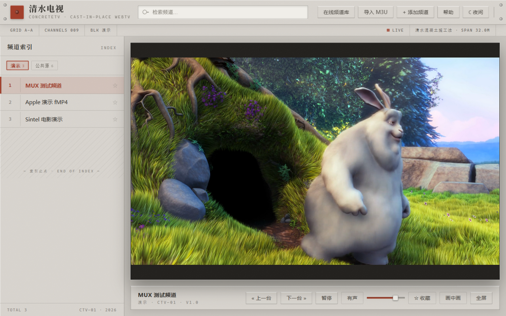

# 清水电视 ConcreteTV

> 浇筑一体的网络电视播放器 · A cast-in-place WebTV player

清水混凝土（Brutalist / 安藤忠雄式）风格的纯前端 IPTV 播放器。单文件运行，无后端、无追踪，数据只存在你的浏览器里。



## 特性

- **HLS 直播播放** — 基于 [hls.js](https://github.com/video-dev/hls.js)，Safari 走原生 HLS；缓冲提示、致命错误自动软恢复、失败一键重试
- **多源频道管理** — 分组切换（收藏 / 演示 / 在线库 / 导入 / 公共源 / 自定义）、实时搜索、频道收藏
- **在线频道库** — 一键拉取 [iptv-org](https://github.com/iptv-org/iptv) 公开中国频道列表（数百个台）
- **M3U 导入** — 支持粘贴链接或文本，自动解析 `#EXTINF` 频道名与 `group-title` 分组
- **自定义频道** — 手动添加任意 m3u8 / mp4 直链
- **电视式操作** — 换台 OSD、数字选台、上一个/下一个、音量、静音、画中画、全屏
- **昼夜双主题** — 白昼混凝土 / 夜色混凝土，跟随系统偏好并记忆选择
- **本地持久化** — 收藏、自定义频道、主题、音量、上次频道，全部存在 localStorage
- **性能** — 长频道列表分块渲染（IntersectionObserver 惰性续载）

## 快捷键

| 按键 | 功能 |
| --- | --- |
| `↑` / `PgUp`，`↓` / `PgDn` | 上一个 / 下一个频道 |
| `0–9` | 数字选台（回车确认或稍候自动换台） |
| `Space` | 播放 / 暂停 |
| `←` / `→` | 音量 − / ＋ |
| `M` / `F` | 静音 / 全屏 |
| `/` / `?` | 聚焦搜索 / 帮助 |

## 使用

直接打开 [GitHub Pages 在线版](https://slatinwine.github.io/concrete-tv/)，或本地运行：

```bash
git clone https://github.com/slatinwine/concrete-tv.git
cd concrete-tv
# 任选一种静态服务器
python -m http.server 8000
npx serve
```

浏览器访问 `http://localhost:8000` 即可。整个应用只有一个 `index.html`。

## 关于直播源

内置「演示」分组为官方测试流，可稳定播放；「公共源」与「在线频道库」来自网络公开渠道，**部分源可能失效或受地域限制**，播不出时换台即可。你也可以导入任何自己的 M3U 播放列表。

## 技术栈

原生 HTML / CSS / JavaScript，唯一运行时依赖为 CDN 引入的 hls.js。纹理、对拉螺栓孔、模板缝等混凝土质感全部由 CSS 实现（SVG feTurbulence 噪点 + 渐变）。

## License

[MIT](LICENSE)

---

## 关注

| 公众号 | 小红书 · 酒里加盐 |
| :---: | :---: |
|  |  |

小红书号 `6100441379` · 酒馆会往酒里加盐，让顾客越喝越渴
